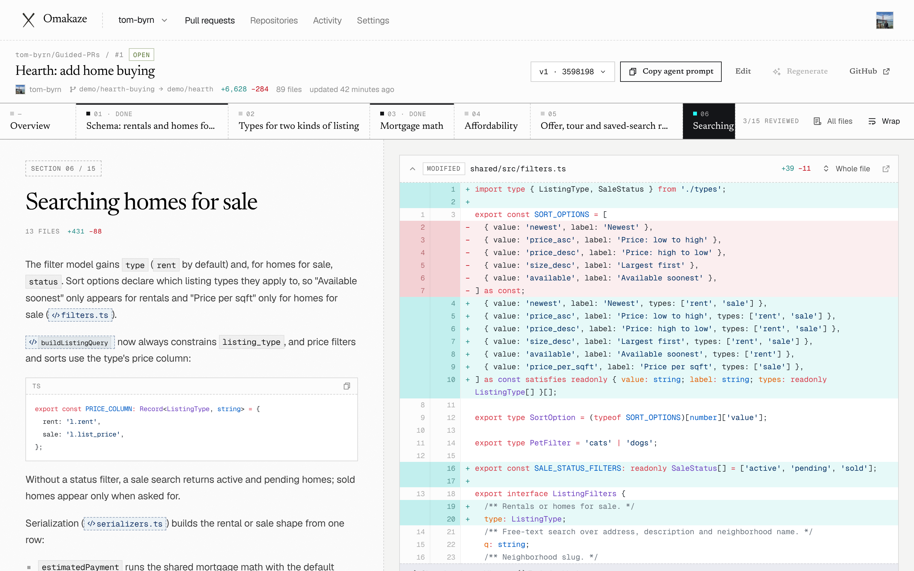

# Omakaze

Omakaze is an open-source, self-hostable web app that turns GitHub pull requests into guided walkthroughs. A guide splits a pull request into ordered sections. Each section has a markdown explanation on the left and the parts of the diff it covers on the right, so reviewers read the change in a planned order instead of file by file. Guides are written by coding agents through the built-in MCP server, by the built-in AI generator, through the REST API, or by hand in the editor. Comments and reviews made in Omakaze are posted to the pull request on GitHub.



## Demo

[omakaze-demo.mp4](docs/demo/omakaze-demo.mp4) (7 minutes, no sound) is a recording of a self-hosted instance and a real pull request, [tom-byrn/Guided-PRs#1](https://github.com/tom-byrn/Guided-PRs/pull/1), which adds home buying to a small rental listings app. It shows connecting GitHub, a coding agent writing the guide through the MCP server, reviewing it section by section, a line comment and a review posted to GitHub, a teammate joining through an invite link, and the settings. The recording script is in [scripts/demo](scripts/demo).

## Features

- **Sections instead of files.** A section references whole files, individual hunks or line ranges, so one file can appear in several sections.
- **Coverage.** Omakaze counts which changed lines belong to a section. Changes that no section covers go to an automatic "Other changes" section when a guide is published.
- **Markdown explanations.** GitHub-flavored markdown with Mermaid diagrams, math, alert blocks, syntax-highlighted code blocks, images, videos and `diff:` links that jump to specific lines of the diff.
- **Diff view.** Syntax highlighting, context that expands 20 lines at a time, to the enclosing block or to the whole file, an all-files view and optional line wrapping.
- **Reviews on GitHub.** Line and multi-line comments, replies, deleting your own comments, and approve, request changes or comment. Everything is posted to the pull request.
- **Review progress.** Mark sections as reviewed and see which other members reviewed them.
- **Versions.** Every new guide for a pull request is a new version; older versions stay available. A guide written for an older head commit is marked as outdated.
- **MCP server.** 17 tools and one prompt over Streamable HTTP at `/api/mcp`. Clients authenticate with OAuth 2.1 (dynamic client registration and PKCE) or an API token.
- **Built-in AI generation.** OpenRouter (default), Anthropic, OpenAI or an OpenAI-compatible server such as Ollama, vLLM or LM Studio.
- **REST API.** List pull requests, read and create guides, and start AI generation.
- **Automation.** Generate a guide when a pull request opens, create a new version when commits are pushed, skip drafts, and post a summary comment on the pull request.
- **Workspaces.** Members with owner, admin and member roles, invite links (optionally limited to one confirmed email address) and an activity log.
- **GitHub access.** A GitHub App installation (the app can be created from the admin page in one step), a personal access token, or a member's linked GitHub account. GitHub Enterprise Server is supported.
- **Sign-in.** Email and password, GitHub, or a GitHub personal access token. Sign-up can be limited to invites or to email domains.
- **Self-hosted.** One container and PostgreSQL. Database migrations and the background worker run inside the app process. A release workflow publishes the image to GitHub Container Registry.

## How it works

1. **Connect GitHub.** Create a workspace, connect it to GitHub and choose the repositories to follow. Everyone in the workspace sees the same pull requests and guides.
2. **Write the guide.** Ask a coding agent to create it through the MCP server, generate it with the built-in AI, call the REST API, or write it in the editor. People who have the pull request open see sections appear while the guide is written.
3. **Review in sections.** Read each explanation next to the code it covers, mark sections as reviewed, and comment. Comments, approvals and change requests go to GitHub.

## Quick start with Docker

Requirements: Docker with Docker Compose.

```sh
git clone https://github.com/tom-byrn/guided-prs.git
cd guided-prs
cp .env.example .env
```

Generate a secret and set it as `APP_SECRET` in `.env`:

```sh
openssl rand -hex 32
```

If the instance will not be served at `http://localhost:3000`, also set `APP_URL` to its public URL. Then start the app and its database; Compose builds the image from your checkout:

```sh
docker compose up -d
```

1. Open http://localhost:3000 and create an account. The first account on an instance becomes the instance admin.
2. Create the GitHub App from `/admin` (on your personal account or an organization), or set the `GITHUB_APP_*` and `GITHUB_CLIENT_*` variables for an existing app. See [docs/github-app.md](docs/github-app.md).
3. Link your GitHub account on the **Account** page, with **Link GitHub account** or a personal access token. Installing the app requires it.
4. In your workspace, open **Settings → GitHub** and choose **Install on GitHub** (or add a token connection), then add repositories on the **Repositories** page.

See [docs/self-hosting.md](docs/self-hosting.md) for HTTPS, backups, upgrades and running without Docker.

## Connect an agent

The MCP server is at `<APP_URL>/api/mcp`. Clients that support OAuth open the instance in a browser, where you sign in and choose the workspace the agent may use.

Claude Code:

```sh
claude mcp add --transport http omakaze <APP_URL>/api/mcp
```

Codex:

```sh
codex mcp add omakaze --url <APP_URL>/api/mcp
```

Cursor (`mcp.json`):

```json
{ "mcpServers": { "omakaze": { "url": "<APP_URL>/api/mcp" } } }
```

VS Code (`mcp.json`):

```json
{ "servers": { "omakaze": { "type": "http", "url": "<APP_URL>/api/mcp" } } }
```

Clients without OAuth support can send an API token created in **Settings → API tokens & MCP**:

```sh
claude mcp add --transport http omakaze <APP_URL>/api/mcp \
  --header "Authorization: Bearer <token>"
```

For each pull request, give the agent this prompt:

```text
Create a guided PR for <PR URL> using the Omakaze MCP.
```

**Settings → API tokens & MCP** also shows a setup prompt that asks an agent to add the server itself. The tools, reference syntax and authentication details are in [docs/mcp.md](docs/mcp.md).

## Built-in AI

Omakaze can write guides itself with OpenRouter (default), Anthropic, OpenAI or an OpenAI-compatible server. Configure a provider per workspace in **Settings → AI provider**, or set instance defaults with `AI_PROVIDER`, `AI_MODEL`, `AI_API_KEY` and `AI_BASE_URL`. Then use **Generate with AI** on a pull request, turn on automation in **Settings → Automation**, or call `POST /api/v1/generate`. The diff is sent to the provider you configure; a local model through the OpenAI-compatible provider keeps it on your network. See [docs/ai.md](docs/ai.md).

## Documentation

| Document | Contents |
| --- | --- |
| [Self-hosting](docs/self-hosting.md) | Docker Compose, running without Docker, HTTPS, storage, backups, upgrades, proxies, GitHub Enterprise Server |
| [GitHub App](docs/github-app.md) | Creating and installing the GitHub App, other ways to connect GitHub, sign-in with GitHub, token permissions |
| [Configuration](docs/configuration.md) | Every environment variable, workspace settings and roles |
| [MCP server](docs/mcp.md) | Authentication, client setup, tool reference, diff references, example session |
| [REST API](docs/api.md) | `/api/v1` endpoints and a GitHub Actions example |
| [AI generation](docs/ai.md) | Providers, the generation pipeline, automation, cost and privacy |
| [Architecture](docs/architecture.md) | Components, request flows, data model, security model, background jobs |
| [Development](docs/development.md) | Local setup, scripts, project structure, tests, migrations |

## Development

Requirements: Node.js 22, pnpm (through Corepack) and PostgreSQL 16.

```sh
corepack enable
pnpm install
docker run -d --name omakaze-db -p 5432:5432 \
  -e POSTGRES_USER=omakaze -e POSTGRES_PASSWORD=omakaze -e POSTGRES_DB=omakaze \
  postgres:16-alpine
cp .env.example .env   # then set APP_SECRET
pnpm dev
```

The app runs at http://localhost:3000 and applies migrations on start. See [docs/development.md](docs/development.md), [CONTRIBUTING.md](CONTRIBUTING.md) and [SECURITY.md](SECURITY.md).

## License

[MIT](LICENSE). The landing page uses a subset of Shippori Mincho, licensed under the [SIL Open Font License 1.1](src/app/fonts/OFL-ShipporiMincho.txt).
