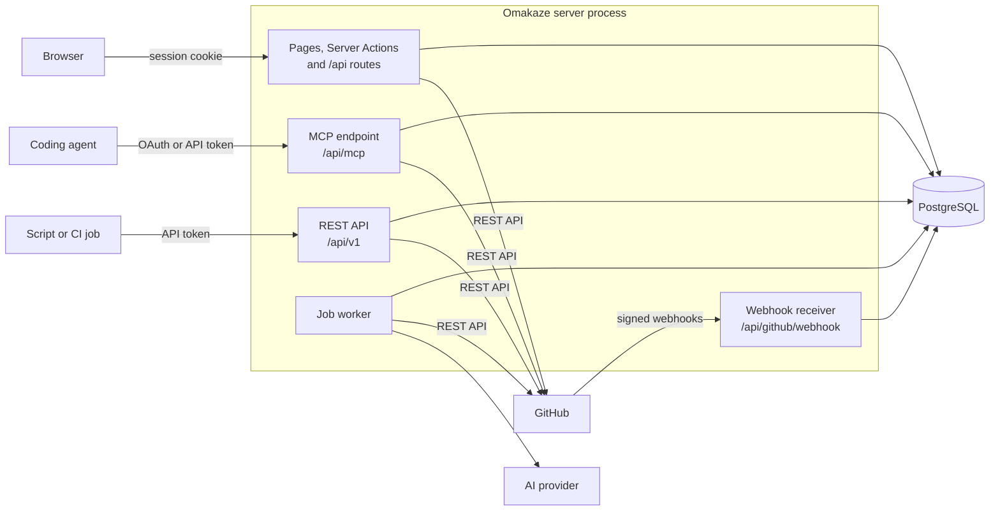
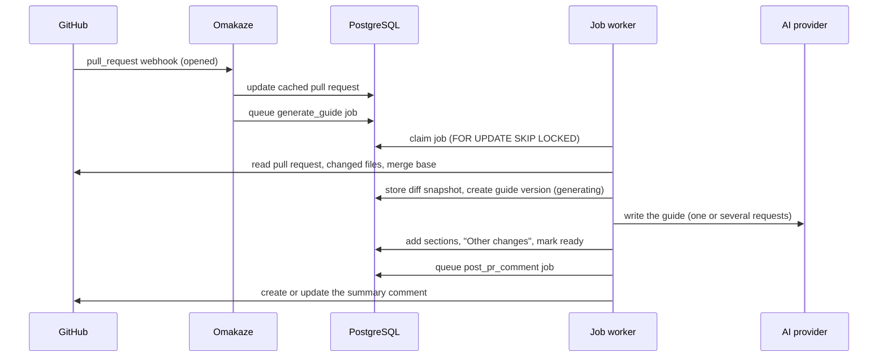
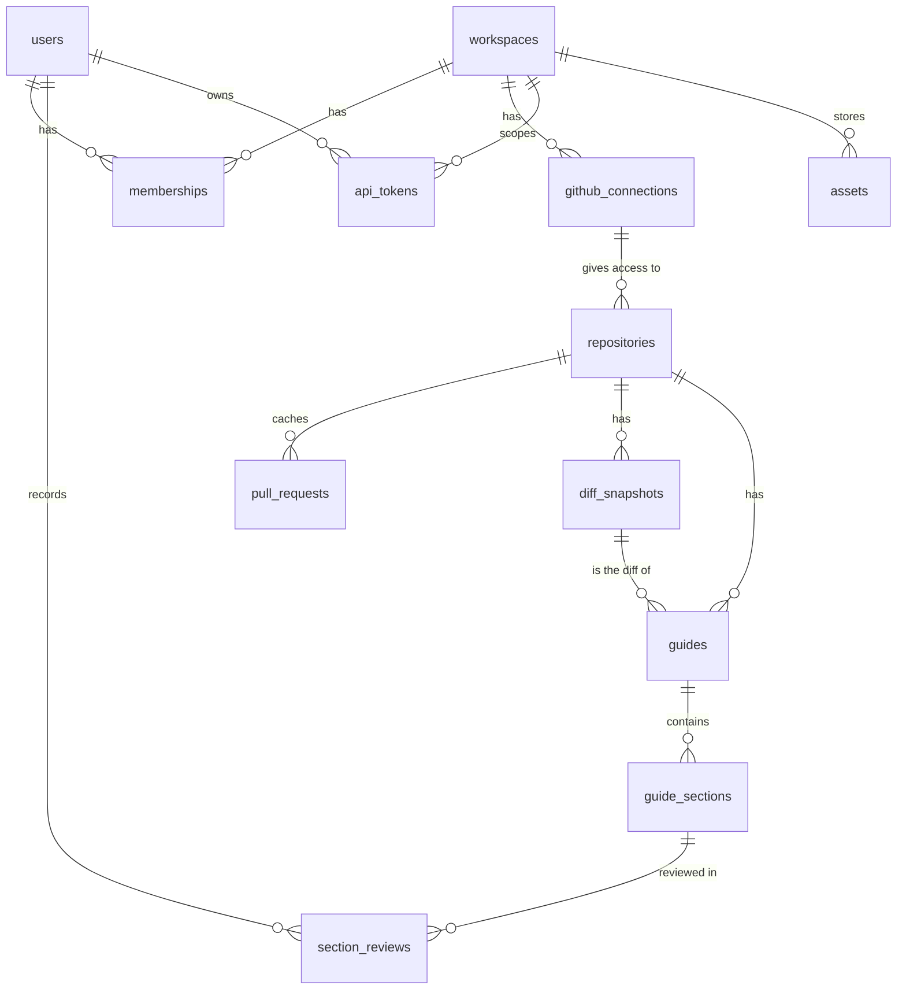

# Architecture

Omakaze is a single Next.js 16 application (App Router, TypeScript) backed by PostgreSQL through Drizzle ORM. There is no separate worker service, cache or object store.

## Components

| Component | Where | Role |
| --- | --- | --- |
| Next.js server | `src/app` | Pages, Server Actions for forms, and route handlers under `src/app/api` |
| PostgreSQL | `src/db` | All state: users, workspaces, cached GitHub data, diff snapshots, guides, the job queue, OAuth clients and tokens, and uploads when `STORAGE_DRIVER=database` |
| Job worker | `src/lib/jobs` | Runs inside the server process (started from `src/instrumentation.ts` when `WORKER_ENABLED` is true): AI generation, summary comments and polling |
| MCP endpoint | `src/app/api/mcp`, `src/lib/mcp` | Stateless Streamable HTTP endpoint with 17 tools for coding agents |
| OAuth server | `src/lib/oauth`, `src/app/.well-known`, `src/app/api/oauth`, `src/app/oauth` | OAuth 2.1 authorization server for MCP clients |
| REST API | `src/app/api/v1` | Token-authenticated API for scripts and CI |
| GitHub integration | `src/lib/github` | REST API client, GitHub App, connections, pull requests, reviews, webhooks |
| AI providers | `src/lib/ai` | Anthropic SDK and OpenAI-compatible chat completions |

On start, `src/instrumentation.ts` applies pending migrations (unless `RUN_MIGRATIONS_ON_START=false`) and, when `WORKER_ENABLED` is true, starts the worker.

## Request flows

Automatic generation, from webhook to summary comment:

An agent follows a similar path through `/api/mcp`: `get_pull_request` stores the diff snapshot, and `create_guide` or `start_guide`, `add_section` and `finish_guide` write the guide.

## Data model

The schema is in `src/db/schema.ts`; migrations are in `drizzle/`.

| Area | Tables |
| --- | --- |
| Users and sign-in | `users` (including `email_verified_at`, set when the address is confirmed), `sessions`, `github_accounts` (one linked GitHub identity per user) |
| Workspaces | `workspaces` (including AI and automation settings and the guide template), `memberships` (role per user), `invites` |
| GitHub | `github_connections` (app installation, token or linked account), `repositories` (followed per workspace, through one connection or none, with an optional guide template override), `pull_requests` (cache) |
| Guides | `diff_snapshots`, `guides` (one row per version, with a copy of the guide template it was started with), `guide_sections`, `section_reviews`, `guide_views` |
| Reviews | `comments` (comments and reviews posted through Omakaze) |
| API access | `api_tokens` (personal tokens and OAuth access tokens), `oauth_clients`, `oauth_codes`, `oauth_refresh_tokens` |
| Uploads | `assets`, `asset_blobs` |
| Operations | `jobs`, `activity`, `webhook_deliveries`, `instance_settings` (holds the GitHub App created on `/admin`) |

Relations to know about:

- Deleting a workspace deletes everything that belongs to it.
- Deleting a connection sets `repositories.connection_id` to null, so the repositories and their guides stay (see [github-app.md](github-app.md#repositories-without-a-connection)). Deleting a repository deletes its pull requests, snapshots, guides and comment records.
- A guide is identified by repository, pull request number and version. Each new guide for a pull request gets the next version number.
- Section refs are stored as JSON (`guide_sections.refs`) in the object form described in [mcp.md](mcp.md#diff-references).

## Diff snapshots and stable hunk numbers

A diff snapshot is an immutable copy of a pull request's diff at one head commit, unique per repository, pull request number and head SHA. It stores:

- the changed files from GitHub's pull request files API (up to 3,000 files), each with status, previous path for renames, line counts and the patch text; GitHub omits the patch for binary and very large files;
- the head SHA, the base SHA and the merge base, found with the compare API (the base SHA is used if that call fails). Old-side line numbers refer to the merge base;
- a `truncated` flag when GitHub reports more changed files than it returned.

Hunk numbers are the 1-based positions of the `@@` hunks in a file's stored patch. Every guide points to the snapshot it was written against, and snapshots are never changed. A ref such as `src/a.ts#2` therefore selects the same lines for as long as the guide exists, even after the pull request receives new commits: the next guide is written against a new snapshot, and the older guide is marked as outdated in the viewer. Agents pass `head_sha` so that a guide is only created while the pull request is still at the commit they read (see [mcp.md](mcp.md#head_sha-and-changing-pull-requests)).

Coverage is computed from the same snapshot (`src/lib/guides/refs.ts`): every added and removed line is checked against the refs of all sections.

## File views and highlighting

The right pane loads one file at a time from `GET /api/guides/<id>/file?path=...` (`src/lib/diff/fileview.ts`):

1. The patch from the snapshot is parsed into hunks.
2. The file is fetched from GitHub's contents API at the head commit, and at the merge base (using the previous path for renamed files) when the patch removes lines. Files larger than 2 MB, binary files and files of more than 6,000 lines are not used.
3. The fetched contents are compared with the patch. They are used only if every line in the patch matches the line with the same number.
4. Shiki tokenizes the contents on the server with the `github-light` theme. The response contains compact tokens and a color palette rather than HTML.
5. If the contents are not available, only the lines of the patch are highlighted, and unchanged lines between hunks cannot be expanded.

With full contents, the viewer can show more context in steps of 20 lines, the enclosing block (found by indentation) or the whole file. Rendered file views are cached in memory (150 per process) and sent with `Cache-Control: private, max-age=3600`. Building a file view needs the repository's GitHub connection; for a repository without one, the request fails with 409. The print layout of a guide (`pull/<number>/print`) builds the same views on the server for every file its sections reference, and falls back to the patch alone without a connection. Code blocks in markdown are also highlighted with Shiki on the server.

The file endpoint also returns moved and copied blocks (`src/lib/diff/moves.ts`). Runs of added lines are matched, ignoring indentation, against the base versions of the files the pull request touches (the 40 most changed, fetched once per snapshot and cached), or against the patches alone without a GitHub connection. A block needs at least 3 lines and 40 word characters. It is "moved" when most of its original lines were deleted, and those deleted lines point to the longest block that took them; otherwise, and for any further destination, it is "copied". Edits within a single hunk are not reported as moves.

## Security model

**Sessions.** Signing in creates a random 32-byte token, stored in the `omk_session` cookie (`HttpOnly`, `SameSite=Lax`, `Secure` when `APP_URL` uses HTTPS). The database stores only its SHA-256 hash. Sessions expire after 30 days without use. Passwords are hashed with scrypt (N = 2^15, r = 8, p = 1). Changing the password signs out other sessions.

**Tokens.** API tokens, OAuth access and refresh tokens, authorization codes, OAuth client secrets and invite tokens are stored as SHA-256 hashes and looked up by hash. API tokens are shown once, when they are created. API and OAuth tokens are bound to one workspace and stop working when their user leaves it. Revoking an OAuth access token also revokes the refresh token issued with it. The OAuth server only accepts the MCP endpoint (or the instance URL) as a `resource` and only grants the `mcp` scope.

**Invites.** An invite restricted to an email address can only be accepted by an account with that address and a confirmed `email_verified_at`. The address is confirmed when it is one of the user's verified GitHub emails, or through a signed link (HMAC, valid 24 hours) that is emailed to the address and must be opened by the same signed-in user. Changing the address clears the confirmation.

**Secrets at rest.** GitHub access and refresh tokens, connection tokens, workspace AI keys, the GitHub App private key and secrets created on `/admin`, and invite links are encrypted with AES-256-GCM. The key is derived from `APP_SECRET` with HKDF-SHA256. State passed through GitHub sign-in, app creation and app installation is signed with HMAC-SHA256 under keys derived the same way, and expires.

**Webhooks.** `/api/github/webhook` verifies `X-Hub-Signature-256` with a constant-time comparison against the GitHub App's webhook secret and the repository webhook secret, and rejects other requests with 401. Deliveries are de-duplicated by `X-GitHub-Delivery`.

**Cross-site requests.** Forms use Server Actions, which Next.js protects by comparing the `Origin` header with the host. JSON endpoints that use the session cookie and change data (`/api/guides/<id>/comments`, `/progress`, `/review`, `/api/assets`, `/api/w/<slug>/sync`) reject requests whose `Origin` is neither `APP_URL` nor the request's own origin. Requests without an `Origin` header (non-browser clients) are allowed. Responses carry `X-Content-Type-Options: nosniff`, `Referrer-Policy: strict-origin-when-cross-origin` and `X-Frame-Options: SAMEORIGIN`.

**Access checks.** Workspace pages, actions and APIs check membership and role (member, admin, owner; see [configuration.md](configuration.md#roles)). Guides, comments and file views are only served to members of the guide's workspace; a token for another workspace gets 404. `/admin` returns 404 for users who are not instance admins.

**Uploads.** Files are served only to signed-in members of the upload's workspace or to tokens of that workspace, with `X-Content-Type-Options: nosniff`. SVG files get a `Content-Security-Policy` with `sandbox`. Allowed types are fixed (images, videos and PDF). Downloads for `upload_asset` (`src/lib/storage/remote.ts`) resolve the host name, refuse private, loopback, link-local and other reserved IPv4 and IPv6 addresses, connect to the address that was checked, check every redirect again and stop at the size limit; see [mcp.md](mcp.md#downloads-from-a-url).

**Markdown.** Raw HTML in guides is sanitized with `rehype-sanitize`; video, details and a few other tags are allowed.

**Rate limits.** These limits are kept in memory per process:

| Action | Limit |
| --- | --- |
| Email sign-up | 10 per hour per client address |
| Email sign-in | 10 per 15 minutes per email address and client address, 50 per 15 minutes per client address, and 100 per 15 minutes per email address |
| Token sign-in | 20 per 15 minutes per client address |
| OAuth client registration | 30 per hour per client address, and 500 per hour in total |
| Invite confirmation emails | 3 per hour per user and invite |

The client address is the `X-Forwarded-For` entry `TRUST_PROXY_HOPS` places from the right (`src/lib/http.ts`), or `X-Real-IP` when the header is missing. See [self-hosting.md](self-hosting.md#https-and-reverse-proxies).

**GitHub credentials.** Reviews and comments use the reviewer's own GitHub credential when possible, so GitHub attributes them to the reviewer. Approvals and change requests are never posted through a shared connection. See [github-app.md](github-app.md#posting-comments-and-reviews).

## Background jobs

Jobs are rows in the `jobs` table (`src/lib/jobs`):

| Job | Queued by | Max attempts |
| --- | --- | --- |
| `generate_guide` | **Generate with AI**, `POST /api/v1/generate`, automation | 2 |
| `post_pr_comment` | Publishing a guide when summary comments are on | 3 |
| `poll_repos` | The scheduler | 1 |

- **Claiming.** Each worker loop claims the next due job with `UPDATE ... WHERE id = (SELECT ... FOR UPDATE SKIP LOCKED LIMIT 1)`, so several loops and several processes can share the queue. A process runs `WORKER_CONCURRENCY` loops (default 3); idle loops check for work about every two seconds.
- **Retries.** A failed job is queued again after 15 seconds, doubling with each further attempt up to 10 minutes, until it reaches its maximum attempts. Errors marked as permanent are not retried.
- **Generation jobs.** A `generate_guide` job from automation creates its guide version when it first runs and stores the guide ID in the job, so a retry continues the same version. Every attempt starts by removing the sections of earlier attempts. When the job gives up, the guide is marked as failed.
- **De-duplication.** Jobs can carry a key; only one queued or running job per key is allowed. Automatic generation uses one key per repository, pull request and head commit. Polling uses one key per interval window, and a key that has already run is not queued again.
- **Recovery and cleanup.** Jobs that have been running for more than 20 minutes are assumed to belong to a stopped process and are queued again. Guides left in the `generating` state with no change for 60 minutes are marked as failed (`STALE_GUIDE_MINUTES` in `src/lib/guides/service.ts`), unless a `generate_guide` job for the guide is still queued or running. Finished and failed jobs older than 14 days are deleted from time to time.
- **Scheduler.** Each process with the worker enabled runs a scheduler every 30 seconds. It requeues stuck jobs, fails abandoned guides and, when `POLL_INTERVAL_SECONDS` is greater than 0, queues the `poll_repos` job of the current interval window, so polling runs once per interval across all processes.

## Caches

These caches are kept in memory per process and are not shared between instances:

| Cache | Contents |
| --- | --- |
| GitHub responses | ETags and bodies of up to 1,000 GET responses, for conditional requests |
| Installation tokens | GitHub App installation tokens until five minutes before they expire |
| GitHub App configuration | The app created on `/admin`, for 30 seconds |
| File views | Up to 150 rendered files |
| Review comments | A pull request's review comments, for 10 seconds or until a review webhook for the pull request arrives |
| Rate limits | Counters for the limits above |

The pull request list itself is cached in PostgreSQL (`pull_requests`) and refreshed by webhooks, polling and when members open the workspace.
