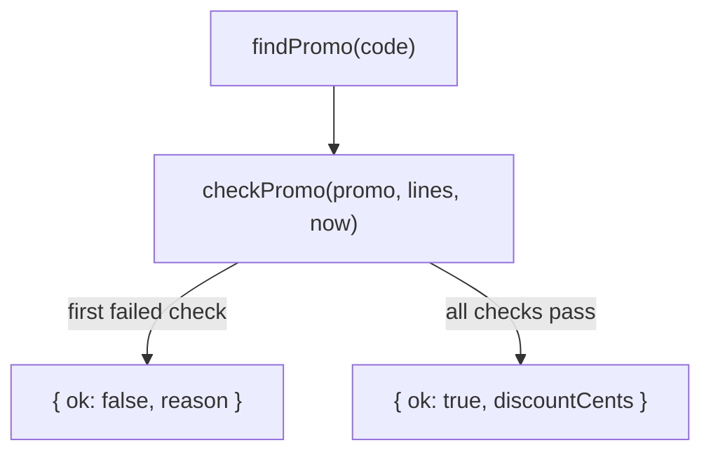

<!-- summary -->
Customers can now enter a promo code in the cart. A code is checked against its dates, the minimum subtotal and its redemption limit; the discount comes off the subtotal before tax; and checkout counts the redemption in the same transaction that creates the order, so the last use of a limited code can't be taken twice.

| | Before | After |
| --- | --- | --- |
| Cart | Subtotal, tax, total | Promo code field and a discount row |
| `POST /api/checkout` | `{ cartId }` | `{ cartId, promoCode? }`, 422 when the code can't be used |
| Tax | 8.25% of the subtotal | 8.25% of the subtotal minus the discount |

`formatMoney` and `roundCents` move from `cart.ts` to a new `money.ts`. `cart.ts` re-exports `formatMoney`, so existing imports keep working.

> [!IMPORTANT]
> The migration adds two columns to `orders`. Both have constant defaults, so PostgreSQL adds them without rewriting the table.

<!-- section: table -->
A promo code is a row in the new `promo_codes` table ([migration]({{diff:migrationTable}})). `kind` decides how `amount` is read:

| `kind` | `amount` | Example |
| --- | --- | --- |
| `percent` | Percent off, 1 to 100 | `WELCOME10`: 10% off |
| `fixed` | Cents off | `FREESHIP`: 500 cents off |

The optional columns limit when and how often a code works: `starts_at`, `ends_at`, `min_subtotal_cents` and `max_redemptions`. `redemptions` counts the orders that used the code.

Codes are unique without regard to case: the [unique index]({{diff:migrationIndex}}) is on `lower("code")`, and the Drizzle schema [declares the same index]({{diff:schemaIndex}}) so `drizzle-kit` doesn't try to drop it.

`orders` gets `discount_cents` and a nullable `promo_code_id` ([schema]({{diff:orderColumns}})). Orders placed before this change keep a discount of 0.

**Check:** the `CHECK` constraints repeat what the application validates. That is deliberate; codes are also created by hand in the admin SQL console.

<!-- section: validation -->
`checkPromo()` is the single place that decides whether a code applies. It takes the code, the cart lines and the current time, and returns either a discount or the first reason the code can't be used:



The checks run in this order, and the first one that fails is the reason:

1. `not_found`: no code with this text.
2. `not_started`: `starts_at` is in the future.
3. `expired`: `ends_at` has passed.
4. `min_subtotal`: the cart is below `min_subtotal_cents`.
5. `used_up`: `redemptions` reached `max_redemptions`.

Each reason maps to a message in [`PROMO_MESSAGES`]({{diff:promoMessages}}); the API returns both, so the UI can show the text and analytics can count the codes.

[`checkPromo`]({{diff:checkPromo}}) is pure: the lookup happens in [`findPromo`]({{diff:findPromo}}) and `now` is a parameter, which is what makes the date checks testable without fake timers.

**Check:**

- The end date is exclusive (`endsAt <= now` is expired); the start date is inclusive.
- [The redemption limit check]({{diff:limitCheck}}) runs on the value read before checkout. The authoritative check is the conditional update in the checkout endpoint (section 4).
- The tests cover each reason except the redemption limit.

<!-- section: totals -->
The discount is taken off the subtotal before tax. Texas taxes the amount the customer actually pays when the store funds the coupon, so tax is computed on the discounted subtotal ([`totals`]({{diff:totals}})).

For a cart of $127.00 with `WELCOME10`:

| Line | Amount |
| --- | --- |
| Subtotal | $127.00 |
| Discount (10%) | −$12.70 |
| Tax (8.25% of $114.30) | $9.43 |
| **Total** | **$123.73** |

```ts
const taxable = Math.max(0, subtotalCents - discountCents);
const taxCents = roundCents(taxable * TAX_RATE);
```

`formatMoney` and `roundCents` [moved unchanged]({{diff:movedHelpers}}) to `src/lib/money.ts`, which also gets [`percentOf`]({{diff:percentOf}}). The diff marks the moved lines, so they don't need a second read. [`discountFor`]({{diff:discountFor}}) caps a fixed discount at the subtotal, so a $50 code on a $20 cart makes the cart free rather than negative.

<!-- section: checkout -->
`POST /api/checkout` accepts an optional `promoCode` ([request body]({{diff:checkoutBody}})). The code is validated first, then the redemption is claimed and the order inserted in one transaction:

1. `validatePromo()` checks the code against the cart (section 2).
2. In one transaction, the [conditional update]({{diff:claim}}) claims a redemption and the order is inserted.
3. The unique index on `orders.cart_id` still turns a double submit into 409.

The update is what enforces the limit: two checkouts racing for the last use both pass `checkPromo`, but only one of them matches a row here.

```sql
UPDATE promo_codes
SET redemptions = redemptions + 1
WHERE id = $1
  AND (max_redemptions IS NULL OR redemptions < max_redemptions)
RETURNING id;
```

| Status | Body | When |
| --- | --- | --- |
| 201 | `{ orderId, totalCents }` | Order created |
| 409 | `{ error }` | Empty cart, or the cart was already checked out |
| 422 | `{ error, code }` | The promo code can't be used; `code` is one of the reasons from section 2 |

`POST /api/promo/preview` runs the same validation without claiming anything, for the cart page.

**Check:** when the claim fails, the transaction [returns `null`]({{diff:claimFailed}}), which the handler reports as "already checked out".

<!-- section: ui -->
The cart page reads the applied code from a `promo` cookie, validates it again on every render and passes the discount to the summary. A code that stopped working since it was applied (it expired or was used up) is dropped without an error.

[`PromoCodeField`]({{diff:promoField}}) calls the preview endpoint, stores the code in the cookie and refreshes the page:

1. The customer enters a code and selects **Apply**.
2. `POST /api/promo/preview` validates it.
3. On success the cookie is set and `router.refresh()` re-renders the server component with the discount.
4. On failure the message from `PROMO_MESSAGES` is shown under the field.

`Summary` is renamed to [`OrderSummary`]({{diff:discountRow}}) and moves to `components/checkout/`. It shows the discount row only when there is a discount.

> [!NOTE]
> The cookie is not `httpOnly`; it only holds the code the customer typed, and the server validates it on every request.
