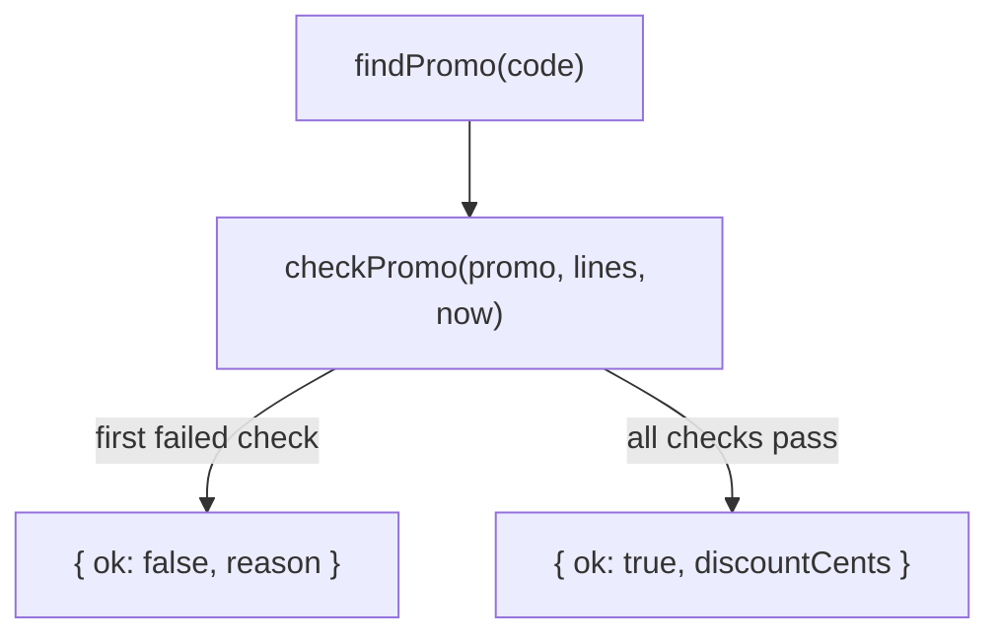

<!-- summary -->
Customers can now enter a promo code in the cart. A code is checked against its dates, the minimum subtotal and its redemption limit; the discount comes off the subtotal before tax; and checkout counts the redemption in the same transaction that creates the order, so the last use of a limited code can't be taken twice.

| | Before | After |
| --- | --- | --- |
| Cart | Subtotal, tax, total | Promo code field and a discount row |
| `POST /api/checkout` | `{ cartId }` | `{ cartId, promoCode? }`, 422 when the code can't be used |
| Tax | 8.25% of the subtotal | 8.25% of the subtotal minus the discount |

`formatMoney` and `roundCents` move from `cart.ts` to a new `money.ts`. `cart.ts` re-exports `formatMoney`, so existing imports keep working.

### Changes since version 1

- Codes are looked up without regard to case, matching the unique index (section 2).
- A code that reached `max_redemptions` is rejected; the check used `>` (section 2).
- A failed redemption claim returns 422 `used_up` instead of 409 (section 4).

> [!IMPORTANT]
> The migration adds two columns to `orders`. Both have constant defaults, so PostgreSQL adds them without rewriting the table.

<!-- section: validation -->
`checkPromo()` is the single place that decides whether a code applies. It takes the code, the cart lines and the current time, and returns either a discount or the first reason the code can't be used:



The checks run in this order, and the first one that fails is the reason:

1. `not_found`: no code with this text.
2. `not_started`: `starts_at` is in the future.
3. `expired`: `ends_at` has passed.
4. `min_subtotal`: the cart is below `min_subtotal_cents`.
5. `used_up`: `redemptions` reached `max_redemptions`.

Each reason maps to a message in [`PROMO_MESSAGES`]({{diff:promoMessages}}); the API returns both, so the UI can show the text and analytics can count the codes.

[`checkPromo`]({{diff:checkPromo}}) is pure: the lookup happens in [`findPromo`]({{diff:findPromo}}) and `now` is a parameter, which is what makes the date checks testable without fake timers.

Since version 1:

- [`findPromo`]({{diff:findPromo}}) compares `lower(code)`, so `welcome10` finds `WELCOME10` and the lookup can use the unique index.
- [The limit check]({{diff:limitCheck}}) uses `>=`. With `max_redemptions = 100`, the 101st checkout is now rejected; a new test covers it.

**Check:** the end date is exclusive (`endsAt <= now` is expired); the start date is inclusive.

<!-- section: checkout -->
`POST /api/checkout` accepts an optional `promoCode` ([request body]({{diff:checkoutBody}})). The code is validated first, then the redemption is claimed and the order inserted in one transaction:

1. `validatePromo()` checks the code against the cart (section 2).
2. In one transaction, the [conditional update]({{diff:claim}}) claims a redemption and the order is inserted.
3. The unique index on `orders.cart_id` still turns a double submit into 409.

The update is what enforces the limit: two checkouts racing for the last use both pass `checkPromo`, but only one of them matches a row here.

```sql
UPDATE promo_codes
SET redemptions = redemptions + 1
WHERE id = $1
  AND (max_redemptions IS NULL OR redemptions < max_redemptions)
RETURNING id;
```

| Status | Body | When |
| --- | --- | --- |
| 201 | `{ orderId, discountCents, totalCents }` | Order created |
| 409 | `{ error }` | Empty cart, or the cart was already checked out |
| 422 | `{ error, code }` | The promo code can't be used; `code` is one of the reasons from section 2 |

Since version 1, a [failed claim]({{diff:claimFailed}}) returns `used_up` and the handler [answers 422]({{diff:usedUpResponse}}) with the same message the preview endpoint uses. The 201 response also includes `discountCents`.

`POST /api/promo/preview` runs the same validation without claiming anything, for the cart page.
